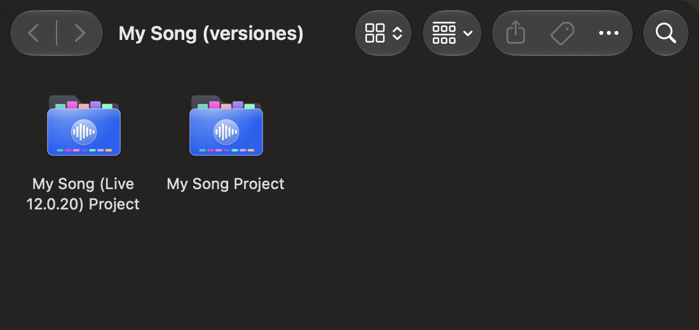
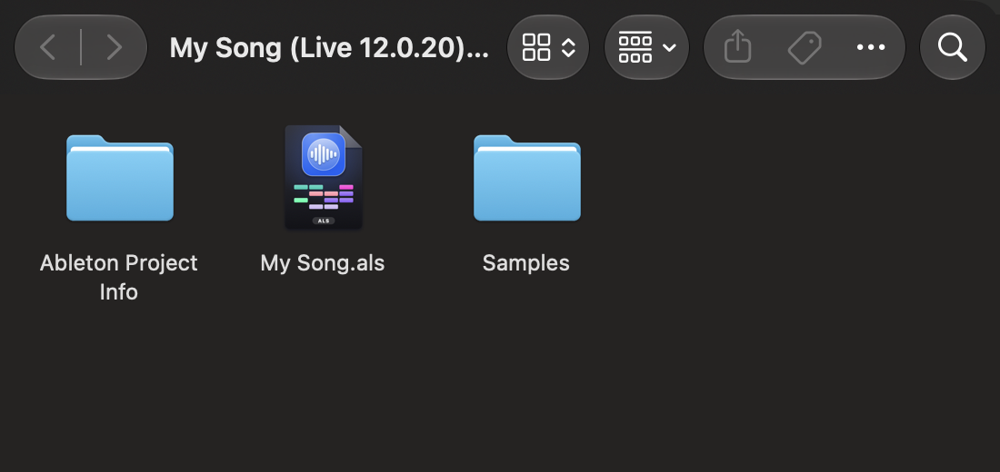
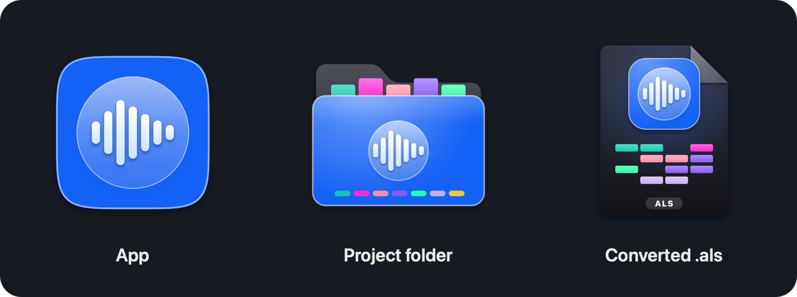

<p align="center">
  
</p>

<h1 align="center">ALS Downgrade</h1>

<p align="center">
  <b>Open newer Ableton Live projects in the older version of Live you have.</b><br>
  Free macOS app · Drag, drop, open in Live · Your original is never touched
</p>

<p align="center">
  <a href="https://github.com/SirAI-stack/als-downgrade/releases/latest"><b>⬇ Download for Mac</b></a>
  &nbsp;·&nbsp; <a href="#how-it-works">How it works</a>
  &nbsp;·&nbsp; <a href="#compatibility">Compatibility</a>
  &nbsp;·&nbsp; <a href="#faq">FAQ</a>
  &nbsp;·&nbsp; <a href="#en-español">Español</a>
</p>

<p align="center">
  
  &nbsp;&nbsp;
  
  &nbsp;&nbsp;
  
</p>

---

## The problem

A friend sends you a project made in **Live 12.4**. You have **Live 12.0**. Live refuses to open it: Ableton's own rule is that [Sets created or saved in later versions of Live cannot be opened in earlier versions](https://help.ableton.com/hc/en-us/articles/360000841004), even between point releases.

The usual workarounds are exporting stems and rebuilding the song, or editing the version number inside the `.als`. The second one often fails, or the project opens and then **crashes while you edit clips**.

**ALS Downgrade converts the project properly**, so it opens and keeps working in your version of Live.

## How it works

**1. Drop** the `.als` file, or the whole project folder, on the window.

**2. It converts** the Set to the exact format your Live understands. It reads the format definitions shipped inside your own copy of Live, removes what your version does not know, adds what it needs, and resets screen state (zoom, panels, selection) to your Live's defaults.

**3. It keeps both versions together.** Your original project is never modified. A complete copy with all its audio is created next to it, and both go into one folder:

```
My Song (versiones)/
├── My Song Project                 ← the original, untouched (Live 12.4)
└── My Song (Live 12.0.20) Project  ← the converted copy, opens in your Live
    ├── My Song.als
    └── Samples/                    ← all the audio, relinked
```

**4. Click Open in Live.** That's it.

Open the same file again later and it reuses your copy, so **your work in it is never overwritten**. If you get a new version of the song, a new numbered copy is created.

## What you see in Finder

Converted projects get their own icons, so you always know which version is which.

<p align="center">
  
  &nbsp;
  
</p>

<p align="center">
  
</p>

## Compatibility

| From | To | Status |
|---|---|---|
| Live 12.4 | Live 12.0 | ✅ Tested in Live with real projects |
| Other Live 12 versions | An older Live 12 | Expected to work, not tested |
| Live 12 | Live 10 or 11 | ⚠️ Experimental, command line only, may not open |
| Anything | Live 9 or older | ❌ Not supported |

Tested with real projects including audio and MIDI tracks, group tracks, return tracks, Drum Racks, MPE notes, take lanes, warped audio and third-party plugins.

**What cannot come back:** devices and features that do not exist in your Live (for example newer MIDI Tools). The app lists everything it removes. Third-party plugins must be installed on your Mac.

## Install

1. Download **[the latest .dmg](https://github.com/SirAI-stack/als-downgrade/releases/latest)**.
2. Open it and drag **ALS Downgrade** to **Applications**.
3. The first time, macOS says the app is from an unidentified developer. Try to open it once, then go to **System Settings → Privacy & Security** and click **Open Anyway**.

Works on Apple Silicon and Intel Macs with macOS 11 or later. If Apple's free Command Line Tools are missing, the app asks macOS to install them.

**Tip:** keep the `.als` inside its project folder so the audio can be found. If the person who sent it used *File → Collect All and Save*, everything will be there.

## FAQ

**Can Ableton Live open a project saved in a newer version?**
Not by itself. Live refuses Sets saved by a newer version, including newer point releases. ALS Downgrade rewrites the Set in the exact format your Live understands.

**Is this the same as editing the version number in the .als?**
No. Changing the header is not enough: Live rejects unknown elements and can crash later. ALS Downgrade rebuilds the Set from the format definitions inside your own Live.

**Will my samples and audio be there?**
Yes. The converted copy contains the project's audio and every file is relinked. If audio is missing, it was missing from what you received; the app lists it.

**Does it change my original project?**
Never. The original stays as it was, inside the "(versiones)" folder.

**My converted project crashes when I edit clips. What do I do?**
That happened with projects converted by hand or by version 1.0. Drop the project on ALS Downgrade 1.1 or newer: it repairs it into a clean copy.

**Can I convert Live 12 projects to Live 11?**
Not reliably yet. Conversions inside Live 12 are tested; Live 10 and 11 targets are experimental.

## Build from source

```bash
git clone https://github.com/SirAI-stack/als-downgrade.git
cd als-downgrade
./build.sh
```

The converter also works from the command line:

```bash
python3 als_downgrade.py "Song Project/"
python3 als_downgrade.py "Song.als" --check
```

## En español

**¿Tu Ableton dice que el proyecto se creó con una versión más nueva de Live?** ALS Downgrade convierte el proyecto para que se abra en la versión de Live que tienes.

1. Suelta el `.als` o la carpeta del proyecto en la ventana.
2. La app crea una copia completa, con todos sus audios, en el formato de tu Live.
3. El original y la copia quedan juntos en una carpeta **«Nombre (versiones)»**. El original nunca se modifica.
4. Pulsa **Open in Live**.

Si vuelves a abrir el mismo archivo, reutiliza tu copia y no sobrescribe tu trabajo. Probado de Live 12.4 a Live 12.0.20.

## Keywords

Ableton downgrade, downgrade Ableton project, open newer Ableton project in older version, Ableton Live Set created with a newer version, open .als in older Ableton, Ableton backwards compatibility, als converter, Live 12.4 to 12.0, Ableton Live 12 to 11, convert Ableton project to older version.

## Credits

By Carni. MIT License.

ALS Downgrade is an independent project, not affiliated with or endorsed by Ableton AG. Ableton and Live are trademarks of Ableton AG.
