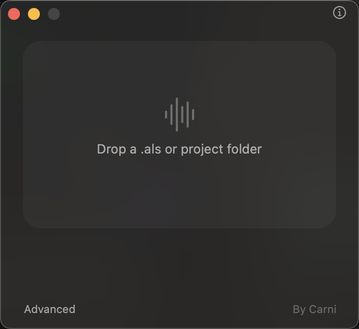
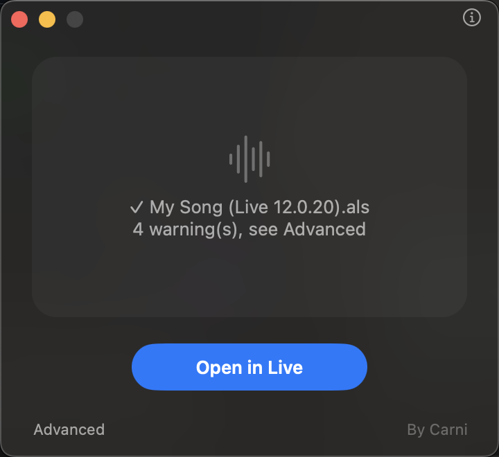
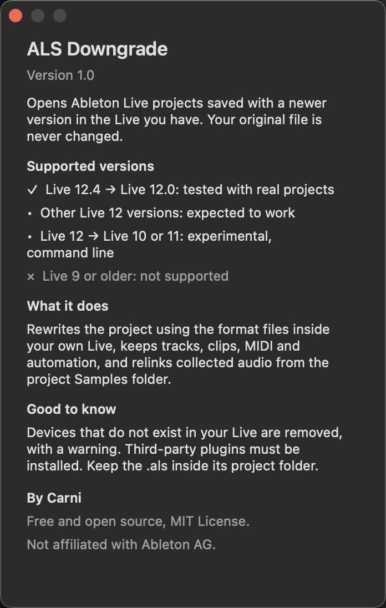

<p align="center">
  
</p>

<h1 align="center">ALS Downgrade</h1>

<p align="center">
  <b>Open newer Ableton Live projects in the older version you have.</b><br>
  Free macOS app. Your original file is never changed.
</p>

<p align="center">
  <a href="https://github.com/SirAI-stack/als-downgrade/releases/latest"><b>Download for Mac</b></a>
</p>

<p align="center">
  
  &nbsp;&nbsp;
  
  &nbsp;&nbsp;
  
</p>

**Can't open an Ableton Live project because it was saved with a newer version of Live?** ALS Downgrade converts the Live Set (`.als`) so you can **open a newer Ableton project in an older version of Live**. It works for whole projects: your audio comes with it, and your original file is never changed.

Ableton's own position is that [Sets created or saved in later versions of Live cannot be opened in earlier versions](https://help.ableton.com/hc/en-us/articles/360000841004), even between point releases such as 12.4 and 12.0. The usual workarounds are exporting stems and rebuilding the song, or editing the version number inside the file, which often fails or crashes Live. ALS Downgrade does the conversion properly instead.

### Typical situations
- A collaborator sends you a project made in **Live 12.4** and you have **Live 12.0**
- You updated Live on one computer and your studio Mac runs an older version
- Your Live Set opens, but **crashes while you edit clips** after a manual downgrade
- You want to **downgrade an Ableton project** without losing tracks, clips, MIDI or automation

## Why it is different

Most guides tell you to edit the version number inside the `.als`. That is often not enough: Live refuses classes it does not know, and can crash after loading. ALS Downgrade instead reads the format schemas shipped inside your own copy of Live and rewrites the project to match them.

- Removes what your version does not understand and adds the fields it requires
- Creates a complete, independent copy of the project (with its audio) and keeps both versions together in one "(versiones)" folder
- Resets screen state (zoom, panels, selection) to your Live's own defaults, which prevents crashes while editing clips
- Never overwrites your work: reopening the same file reuses your copy
- Keeps tracks, clips, MIDI notes, automation and tempo
- Relinks your collected audio from the project `Samples` folder
- Tells you about anything it had to remove
- Accepts a single `.als` or a whole project folder
- Opens the result in Live and confirms that it loaded

## Compatibility

| From | To | Status |
|---|---|---|
| Live 12.4 | Live 12.0.20 | Tested in Live with real projects |
| Other Live 12 versions | An older Live 12 | Expected to work, not tested |
| Live 12 | Live 10 or 11 | Experimental, command line only, may not open |
| Anything | Live 9 or older | Not supported |

Newer features cannot be carried back. Devices that do not exist in your version are removed, and third-party plugins must be installed. Back up important work.

## Download

1. Download **[ALS-Downgrade-1.1.dmg](https://github.com/SirAI-stack/als-downgrade/releases/latest)**.
2. Open it and drag **ALS Downgrade** to **Applications**.
3. First launch: macOS warns that the app is from an unidentified developer. Try to open it once, then go to **System Settings > Privacy & Security** and click **Open Anyway**.
4. Drop your `.als` or project folder on the window.

Works on Apple Silicon and Intel Macs, macOS 11 or later. If Apple's free Command Line Tools are missing, the app asks macOS to install them. Keep the `.als` inside its project folder so audio can be found.

## Build from source

```bash
git clone https://github.com/SirAI-stack/als-downgrade.git
cd als-downgrade
./build.sh
```

## Command line

```bash
python3 als_downgrade.py "Song Project/"
python3 als_downgrade.py "Song.als" --check
```

## En español

**¿Tu Ableton dice que el proyecto se creó con una versión más nueva?** Suelta el `.als` o la carpeta del proyecto en ALS Downgrade y ábrelo en tu versión de Live. El archivo original no se modifica. Probado de Live 12.4 a Live 12.0.20.

## FAQ

**Can Ableton Live open a project saved in a newer version?**
Not by itself. Live refuses Sets saved by a newer version, including newer point releases. ALS Downgrade rewrites the Set in the exact format your Live understands.

**Is this the same as editing the version number in the .als?**
No. Changing the header is not enough: Live rejects unknown elements and can crash later. ALS Downgrade reads the format definitions shipped inside your own copy of Live and rebuilds the Set to match them.

**Will my samples and audio be there?**
Yes. It makes a complete copy of the project folder with its audio and relinks every file. Keep the `.als` inside its project folder.

**Can I convert Live 12 projects to Live 11?**
Not yet reliably. Conversions inside Live 12 are tested; Live 10 and 11 targets are experimental.

**What is lost?**
Devices and features that do not exist in your version (for example newer MIDI Tools). The app lists everything it removes.

## Keywords

Ableton downgrade, downgrade Ableton project, open newer Ableton project in older version, Ableton Live Set created with a newer version, open .als in older Ableton, Ableton backwards compatibility, als converter, Live 12.4 to 12.0, Ableton Live 12 to 11, convert Ableton project to older version.

## Credits

By Carni. MIT License.

ALS Downgrade is an independent project, not affiliated with or endorsed by Ableton AG. Ableton and Live are trademarks of Ableton AG.
